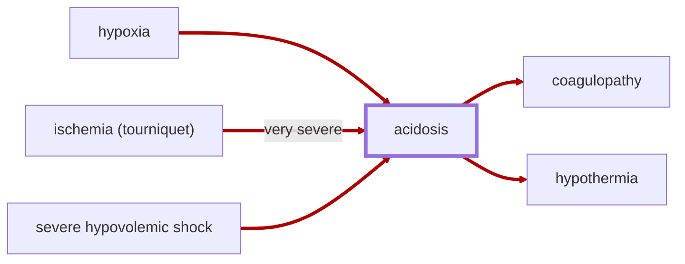

# Acidosis

<!-- @generate_breadcrumb_trail {"template": "_:file_folder: {0}_", "connector": " :arrow_right: "} -->
_:file_folder: [More Injuries User Manual](/docs/wiki/README.md) :arrow_right: [Injuries and Medical Conditions A-Z](/docs/wiki/injuries/README.md) :arrow_right: [Acidosis](/docs/wiki/injuries/acidosis.md)_
<!-- @end_generated_block -->

Acidosis is a serious metabolic condition caused by an excessive buildup of acid in the body, typically caused by inadequate oxygen delivery to tissues ([hypoxia](/docs/wiki/injuries/hypoxia.md)) following severe blood loss ([hypovolemic shock](/docs/wiki/injuries/hypovolemic-shock.md)), [cardiac arrest](/docs/wiki/injuries/cardiac-arrest.md), or other forms of shock. As oxygenated blood stops flowing to the tissues (due to one or more of above conditions), the body shifts to anaerobic metabolism, meaning it starts producing energy without oxygen, which results in the production of lactic acid and the accumulation of carbon dioxide. These byproducts lower the blood pH, leading to acidosis.

The condition contributes to a dangerous cycle known as the [lethal triad of trauma](/docs/wiki/concepts.md#lethal-triad-of-trauma): acidosis, [hypothermia](/docs/wiki/injuries/hypothermia.md), and [coagulopathy](/docs/wiki/injuries/coagulopathy.md). As blood pH drops, blood clotting function becomes impaired, increasing the risk of uncontrolled [hemorrhage](/docs/wiki/injuries/hemorrhage.md) and [trauma-induced coagulopathy](/docs/wiki/injuries/coagulopathy.md). At the same time, acidosis impairs mitochondrial function (the powerhouse of the cell), leading to decreased ATP (energy) production in cells, which is required for thermogenesis and maintaining body temperature. This contributes to [hypothermia](/docs/wiki/injuries/hypothermia.md) and further exacerbates the cycle of trauma.

> **In-Game Description**
> _"**Acidosis** &mdash; Worsening shock and hypoxic injuries raise acidosis, increasing bleeding and hypothermia risks. Stop bleeding, restore blood volume and oxygen delivery, and tend shock well to slow buildup. Acidosis clears gradually once its sources stop."_

*See the section on the [pathophysiological system](/docs/wiki/pathophysiological-system.md#pathophysiological-system) for more information on the graphical representation.*

**Causes**: Sustained severe [hypovolemic shock](/docs/wiki/injuries/hypovolemic-shock.md#hypovolemic-shock), [hypoxia](/docs/wiki/injuries/hypoxia.md) or [severe ischemia after prolonged tourniquet application](/docs/wiki/injuries/ischemia.md#ischemia-tourniquet).

When advanced trauma simulation is enabled, shock above the compensated range can gradually raise acidosis without waiting for a new organ injury. Poor-quality shock tending slows this only slightly. At 40% acidosis the condition is very severe and its contribution to coagulopathy is already severe. Existing hypoxic injuries and severe tourniquet ischemia remain causes.

**Effects**: Directly contributes to [coagulopathy](/docs/wiki/injuries/coagulopathy.md) and [hypothermia](/docs/wiki/injuries/hypothermia.md).

**Treatment**: Restore oxygen delivery to tissues: control bleeding, provide fluid resuscitation, preferably with [blood products](/docs/wiki/medical-devices.md#blood-bag), and treat effects coagulopathy and hypothermia. As long as severe shock keeps producing acidosis, clearance is slow. Restoring enough blood volume can reduce that production immediately, even while the shock entry itself is still recovering. Once the ongoing input and recent hypoxic injury input stop, acidosis clears substantially faster. Wound tending alone does not cancel the existing deficit.

> [!WARNING]
> Acidosis naturally "lags behind" the underlying causes, meaning that it doesn't set in immediately after oxygen delivery to tissues is impaired, and it may take some time for the body to clear metabolic byproducts after oxygen delivery is restored. This means that even after a pawn has been stabilized and blood volume has been restored, they may still suffer from acidosis for a while. Keep a close eye on their condition and be prepared to provide further treatment as needed.

<!-- @generate_link_to_top {"template": "---\n_[back to the top]({1})_"} -->
---
_[back to the top](#acidosis)_
<!-- @end_generated_block -->
