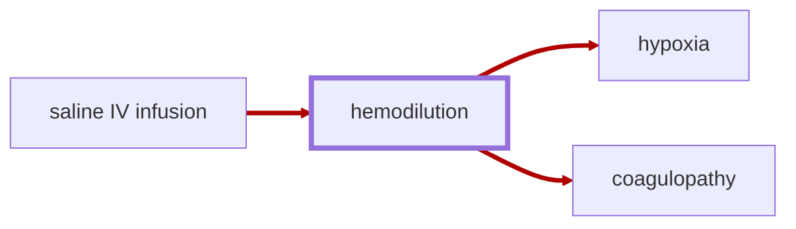

# Hemodilution

<!-- @generate_breadcrumb_trail {"template": "_:file_folder: {0}_", "connector": " :arrow_right: "} -->
_:file_folder: [More Injuries User Manual](/docs/wiki/README.md) :arrow_right: [Injuries and Medical Conditions A-Z](/docs/wiki/injuries/README.md) :arrow_right: [Hemodilution](/docs/wiki/injuries/hemodilution.md)_
<!-- @end_generated_block -->

Hemodilution is a condition that occurs when the concentration of red blood cells in the blood is reduced, such as through excessive usage of [saline IV infusions](/docs/wiki/medical-devices.md#saline-iv-bag) for fluid resuscitation, leading to a decrease in the blood's ability to carry oxygen.

> **In-Game Description**
> _"**Hemodilution** &mdash; Diluted blood increases bleeding and reduces oxygen delivery; above 45%, it can drive cerebral hypoxia. Transfuse blood to reduce dilution. Saline restores volume but worsens dilution; forced single infusions bypass automatic safety checks."_

*See the section on the [pathophysiological system](/docs/wiki/pathophysiological-system.md#pathophysiological-system) for more information on the graphical representation.*

**Causes**: Excessive usage of [saline IV infusions](/docs/wiki/medical-devices.md#saline-iv-bag) for fluid resuscitation, particularly in trauma patients, when large volumes of saline or other intravenous fluids are administered to restore blood volume and pressure after significant blood loss. Keep in mind that dilution will be more pronounced if the patient has already lost a significant amount of blood, as the remaining blood volume will be diluted by the additional fluids. The mathematical model for calculating the dilution effect of saline infusions is described in more detail in the [hemodilution simulation](/docs/wiki/concepts.md#hemodilution-simulation) section.

Each saline bag reduces blood-loss severity by 15 percentage points while increasing dilution; each blood bag reduces blood-loss severity by 35 points and can reduce existing dilution. At 80% blood loss with no dilution, one saline bag leaves 65% blood loss and about 11.1% hemodilution. At 80% blood loss with 40% dilution, one blood bag leaves 45% blood loss and about 31% dilution. The effect depends on the starting state, especially when infusing beyond full volume.

**Effects**: Hemodilution can lead to a significant reduction in the oxygen-carrying capacity of the blood and impair coagulation. Minor and moderate stages reduce consciousness by an offset (`-0.2`, then `-0.4`) instead of a hard cap. Severe combines a 0.8 cap with a `-0.5` offset. Extreme caps consciousness at 0.2. The terminal stage still caps it at 0.01. In severe cases it can result in loss of consciousness, [hypoxia](/docs/wiki/injuries/hypoxia.md#hypoxia) and [dilutional coagulopathy](/docs/wiki/injuries/coagulopathy.md#coagulopathy), both of which can lead to increased risk of [hemorrhage](/docs/wiki/injuries/hemorrhage.md#hemorrhage-spontaneous), organ failure, and death if not managed appropriately.

**Treatment**: Hemodilution will resolve on its own over time as the body regenerates red blood cells and plasma constituents. However, in severe cases of hemodilution, it may be necessary to administer [blood products](/docs/wiki/medical-devices.md#blood-bag) to restore red blood cell and plasma levels immediately, as well as carefully managing fluid resuscitation to prevent further dilution.

With delayed vital failure enabled, hemodilution above 45% contributes to ongoing [cerebral hypoxia](/docs/wiki/injuries/hypoxia.md#cerebral-hypoxia). If severe shock or failed breathing/circulation is also present, the strongest systemic source determines cerebral progression. Blood products can reduce dilution; saline can worsen this oxygen-carrying deficit.

<!-- @generate_link_to_top {"template": "---\n_[back to the top]({1})_"} -->
---
_[back to the top](#hemodilution)_
<!-- @end_generated_block -->
