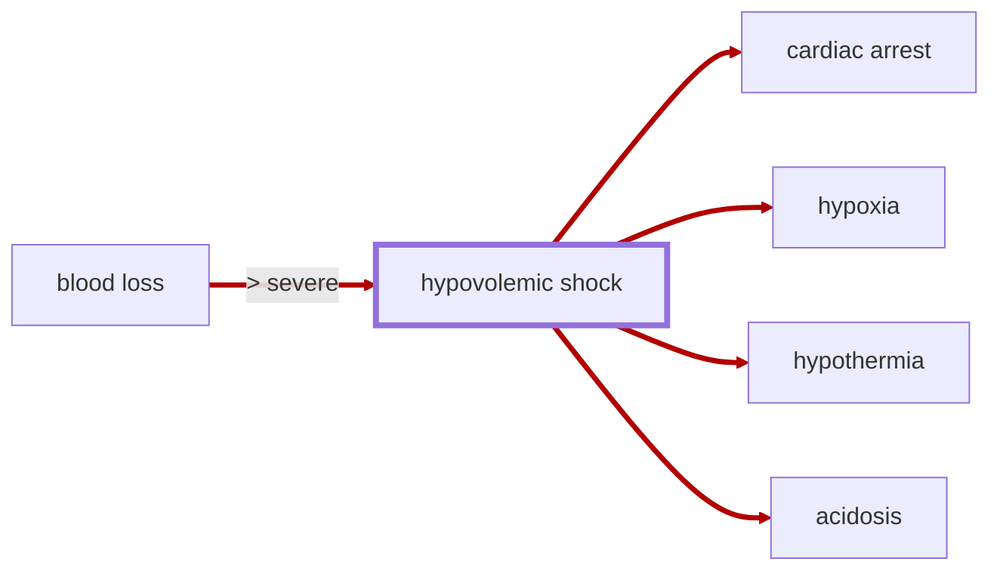

# Hypovolemic Shock

<!-- @generate_breadcrumb_trail {"template": "_:file_folder: {0}_", "connector": " :arrow_right: "} -->
_:file_folder: [More Injuries User Manual](/docs/wiki/README.md) :arrow_right: [Injuries and Medical Conditions A-Z](/docs/wiki/injuries/README.md) :arrow_right: [Hypovolemic Shock](/docs/wiki/injuries/hypovolemic-shock.md)_
<!-- @end_generated_block -->

When a pawn loses a significant amount of blood, there may not be enough blood volume to circulate to the body's organs, leading to a life-threatening condition known as hypovolemic shock. Without immediate treatment, the insufficient blood flow can starve the organs of oxygen and nutrients, causing tissue damage, multiple organ failure, and ultimately death. At the same time, the reduced blood flow prevents body temperature from being adequately maintained, which can lead to [hypothermia](/docs/wiki/injuries/hypothermia.md#hypothermia) and further complications.

> **In-Game Description**
> _"**Hypovolemic shock** &mdash; A life-threatening state caused by insufficient blood flow to the body. Hypovolemic shock is a medical emergency; if left untreated, the insufficient blood flow can cause damage to organs, leading to hypoxia and multiple organ failure. 
> Shock develops when blood loss exceeds 45%. Severity changes gradually with the remaining blood-volume deficit. Stopping the bleeding prevents further loss; restoring blood volume with transfusions or IV fluids allows recovery. The quality of shock tending determines how much it slows worsening, assists recovery, and reduces hypoxia risk. Sustained severe shock can also build acidosis before new organ injuries appear. Adrenaline buys time without lowering the underlying shock target. Existing injuries and complications still require treatment."_

*See the section on the [pathophysiological system](/docs/wiki/pathophysiological-system.md#pathophysiological-system) for more information on the graphical representation.*

**Causes**: Severe blood loss from injuries, such as lacerations, gunshot wounds, or surgical procedures.

With hypovolemic shock enabled, supported pawns develop shock at the next periodic check once blood loss exceeds 45%. Severity then changes gradually rather than jumping to the blood-loss percentage. Humans, fleshy Humanoid Alien Races, and bleeding fleshy Anomaly entities such as fleshbeasts are supported. Ordinary animals remain outside this system.

**Effects**: Hypovolemic shock is a medical emergency that can cause a rapid decline in consciousness, blood pressure, body temperature, and heart rate, leading to [hypothermia](/docs/wiki/injuries/hypothermia.md#hypothermia), [hypoxia](/docs/wiki/injuries/hypoxia.md#hypoxia), multiple organ failure, and [cardiac arrest](/docs/wiki/injuries/cardiac-arrest.md#cardiac-arrest). The remaining blood-volume deficit determines how severe shock can become. Prolonged severe shock can accumulate hypoxic injuries and feed the [death spiral](/docs/wiki/concepts.md#lethal-triad-of-trauma). There is no automatic point of no return at 55% shock. Existing complications can remain dangerous after circulation improves.

**Treatment**: Stop the bleeding and restore blood volume using [saline IV infusions](/docs/wiki/medical-devices.md#saline-iv-bag) or [blood transfusion](/docs/wiki/medical-devices.md#blood-bag). Stopping bleeding alone leaves the existing deficit in place; shock can continue to rise toward the severity associated with that deficit. As blood volume recovers, shock gradually subsides. Keep observing the patient and treat secondary effects such as [hypoxia](/docs/wiki/injuries/hypoxia.md#hypoxia) and [cardiac arrest](/docs/wiki/injuries/cardiac-arrest.md#cardiac-arrest), which are not erased by a transfusion.

During emergency treatment, [epinephrine](/docs/wiki/injuries/adrenaline-rush.md#adrenaline-rush) can temporarily support circulation. The quality of the shock tend determines its protection during the four-hour treatment period. A 15% tend provides only a 7.5% reduction in worsening and hypoxia chance at default settings; a 30% tend provides 15%, and a 100% tend provides 50%. Recovery assistance also scales with quality. Protection ends when the tend expires. Neither treatment replaces missing blood.

With advanced trauma simulation enabled, sustained severe shock can build [acidosis](/docs/wiki/injuries/acidosis.md#acidosis) even before organ injuries appear. A pawn at about 80% blood loss and shock can reach very severe acidosis over roughly 4-6 game hours despite a 15-30% shock tend and stopped bleeding. Better tending buys more time; restoring blood volume addresses the ongoing source. Other injuries, complications, settings, and drugs can change this timing.

> [!TIP]
> As time is of the essence when treating hypovolemic shock, it is recommended to have a stockpile of [saline IV bags](/docs/wiki/medical-devices.md#saline-iv-bag), [blood bags](/docs/wiki/medical-devices.md#blood-bag), or other blood transfusion items ready in your hospital to quickly treat patients with severe blood loss. You may even want to assign some medically skilled pawns to be dedicated combat medics who keep a few blood bags in their inventory at all times to immediately stabilize and treat injured pawns on the battlefield. This can be achieved by telling the medic to "pick up" a number of blood bags (or including blood bags in [Combat Extended](https://github.com/CombatExtended-Continued/CombatExtended) loadouts) and then telling the drafted medic to `transfuse blood (from inventory, stabilize)` to the injured pawn.

> [!TIP]
> If you prefer to avoid an instant death at full blood loss, consider enabling the experimental `Prevent direct death by blood loss` option in the mod settings. For pawns supported by More Injuries, this prevents direct death at the blood-loss cap. Ordinary animals and unsupported races retain their separate blood-loss behavior; bleeding fleshy Anomaly entities are included in the supported group. It does not itself add cerebral hypoxia. Other active mechanisms, such as this shock, can still injure and kill them. Forced blood harvesting can still kill.

> [!NOTE]
> **Biotech DLC**: Deathresting sanguaphages will automatically recover from hypovolemic shock over time, as they can regenerate blood on their own. The Deathless gene clears hypovolemic shock and blocks this shock from causing cardiac arrest.  
> **Odyssey DLC**: The Breathless gene does the same for shock and for cardiac arrest caused by this shock. Either gene is enough. A pawn with no genes is not protected by this.

<!-- @generate_link_to_top {"template": "---\n_[back to the top]({1})_"} -->
---
_[back to the top](#hypovolemic-shock)_
<!-- @end_generated_block -->
