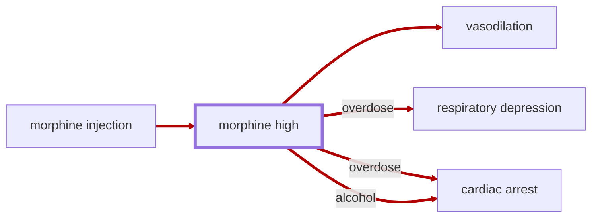

# Morphine High

<!-- @generate_breadcrumb_trail {"template": "_:file_folder: {0}_", "connector": " :arrow_right: "} -->
_:file_folder: [More Injuries User Manual](/docs/wiki/README.md) :arrow_right: [Injuries and Medical Conditions A-Z](/docs/wiki/injuries/README.md) :arrow_right: [Morphine High](/docs/wiki/injuries/morphine-high.md)_
<!-- @end_generated_block -->

> **In-Game Description**
> _"**Morphine high** &mdash; Reduces pain but suppresses breathing and circulation. Dangerous during severe blood loss or resuscitation; excessive doses can be fatal."_

Morphine causes [vasodilation](/docs/wiki/injuries/vasodilation.md#vasodilation), a widening of blood vessels, which decreases vascular resistance and increases blood flow. As such, hemorrhagic resistance is reduced, leading to increased bleeding and a reduced tolerance to [hypovolemia](/docs/wiki/injuries/hypovolemic-shock.md#hypovolemic-shock).

*See the section on the [pathophysiological system](/docs/wiki/pathophysiological-system.md#pathophysiological-system) for more information on the graphical representation.*

**Causes**: Administering a [morphine autoinjector](/docs/wiki/medical-devices.md#morphine-autoinjector).

**Effects**: Euphoria, pain relief, reduced consciousness, and [vasodilation](/docs/wiki/injuries/vasodilation.md#vasodilation). In high doses or when mixed with other depressants like alcohol, it can lead to respiratory depression, [cardiac arrest](/docs/wiki/injuries/cardiac-arrest.md#cardiac-arrest), and death.  
Another adverse effect of morphine is the impediment of resuscitation efforts in case of [cardiac arrest](/docs/wiki/injuries/cardiac-arrest.md#cardiac-arrest) due to its [vasodilating properties](/docs/wiki/injuries/vasodilation.md#vasodilation). Therefore, it is recommended to avoid administering morphine to trauma patients.

**Treatment**: Currently, no specific antidote for morphine overdose has been implemented in the game. Treatment for overdose involves supportive care and treating symptoms as they arise.

**Addiction**: At zero tolerance and without protective genes, each dose has a 5% base chance to cause a morphine addiction. Existing tolerance increases the chance. The addiction adds a morphine need. That need drains over time; when it is empty, withdrawal begins (a strong mood penalty, and a higher chance of a mental break). Another dose of morphine, whether a doctor injects it or the pawn uses the autoinjector, refills the need and ends withdrawal. The addiction itself fades only with abstinence. With Biotech, dependency, resistance, and immunity genes for morphine are already generated from the chemical. A dependency gene prevents a new addiction. Resistance halves tolerance buildup and overdose chance. Immunity blocks both.

**Thoughts per Stage**:
> _"**Slight buzz** (+3) &mdash; Ah... yeah... things aren't as sharp anymore."_  
> _"**Warm pudding limbs** (+10) &mdash; Yeah... that's the stuff. My limbs feel like warm pudding."_  
> _"**Pure euphoria** (+15) &mdash; Wheeeeeeeeeeeeeeeeeeeeeeee."_  
> _"**Drifting away** (-10) &mdash; The pain left, but something stranger came to visit. Whoa... my hands are filled with teeth. Why are they chewing? Huh? ... Oh, the floor just whispered my name and asked me to lie down forever. It's getting hard to breathe... the air is thick like soup, like I'm choking on alphabet letters. Why is gravity apologizing to me? I think I should go to sleep now..."_

> [!WARNING]
> Due to its adverse effects on the respiratory systems, morphine should be used with caution, and patients should be closely monitored for any signs of complications.

**Dose consistency**: Doctor injections and direct use apply the same morphine dose, addiction check, tolerance buildup, and overdose rules. Tolerance can weaken the high while increasing addiction risk; body size and chemical genes apply where configured. An injection also satisfies an existing addiction.

**Inspecting effects**: Open the morphine autoinjector information card or the linked morphine high, tolerance, or addiction information card to see numerical effects. High stages list their severity thresholds and modifiers; addiction cards distinguish withdrawal from the satisfied state. Tolerance cards show drug-effect samples and the configured recovery rate. With Biotech, morphine gene icons show its autoinjector over a large heart for dependency, a half-shield for resistance, or a full shield for immunity.

Repeated doses remain risky: five doses at the base 5% chance give about a 23% chance of at least one addiction roll succeeding. Tolerance and native gene modifiers can change the actual risk. Doctor administration and self-use have the same base chance; doses, tolerance buildup, withdrawal and overdose rules are unchanged.

<!-- @generate_link_to_top {"template": "---\n_[back to the top]({1})_"} -->
---
_[back to the top](#morphine-high)_
<!-- @end_generated_block -->
